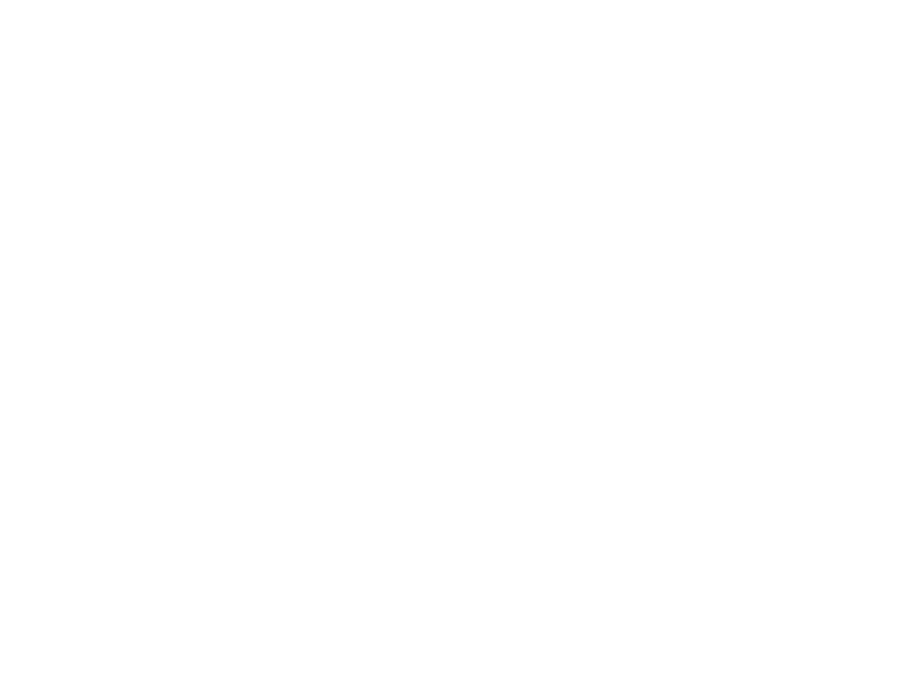

# taobao-user-behavior-analysis
电商用户行为转化与RFM分层分析
# 淘宝用户行为转化与 RFM 分层分析

## 📌 项目背景
基于阿里天池淘宝 UserBehavior 数据集（抽取约 200 万条记录），模拟电商数据分析师角色，对用户的浏览、加购、购买行为进行漏斗拆解，并建立 RFM 模型进行用户价值分层，为精准营销提供数据支持。

## 🛠️ 技术栈
*   **数据处理**：Python (Pandas, NumPy)
*   **机器学习**：Scikit-learn (K-Means 聚类, StandardScaler 标准化)
*   **可视化**：Matplotlib
*   **工具**：Jupyter Notebook, Git, GitHub

## 🔍 核心发现与踩坑记录
1. **漏斗异常与采样偏差**：初步计算严格漏斗时，发现整体转化率高达 53.95%。结合业务常识判断，这属于切片数据带来的“活跃用户偏置”。如果应用全量数据，转化率将被拉低至正常水平。此过程体现了对数据口径的严谨校验。
2. **K-Means 聚类**：利用轮廓系数（Silhouette Score）遍历 K=2 到 K=6，最终得出 K=4 为最佳业务解释粒度。

## 👥 用户分层画像与策略（K=4）

| 簇 (Cluster) | 典型特征 (R, F, M) | 用户占比 | 业务定义 | 运营策略建议 |
| :--- | :--- | :--- | :--- | :--- |
| **Cluster 3** | R极低, F/M极高 | 极少 (166人) | **超级VIP / 核心高净值** | 1对1客服、新品优先体验、生日大额礼包 |
| **Cluster 1** | R低, F/M较高 | 中等 (2111人) | **高价值活跃用户** | 满减凑单提高客单价、跨品类交叉推荐 |
| **Cluster 2** | R低, F/M偏低 | 最多 (6988人) | **新晋潜力首购客** | 7天内推送“第二单专属券”，趁热打铁促复购 |
| **Cluster 0** | R偏高, F/M极低 | 较多 (3998人) | **一般/边缘休眠用户** | 低成本群发唤醒、大促爆款定向Push |

## 📁 仓库结构
*   `notebooks/`：Jupyter Notebook 源码（数据清洗、漏斗计算、K-Means聚类）
*   `visualizations/`：分析生成的图表